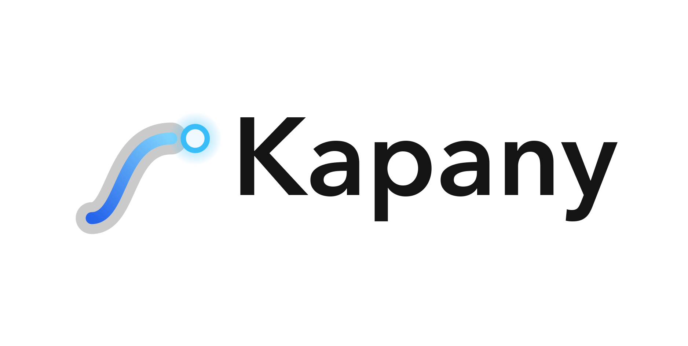
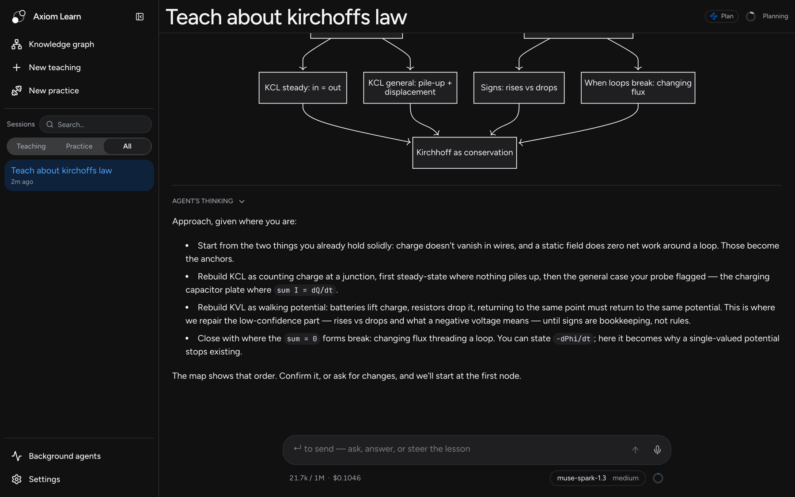
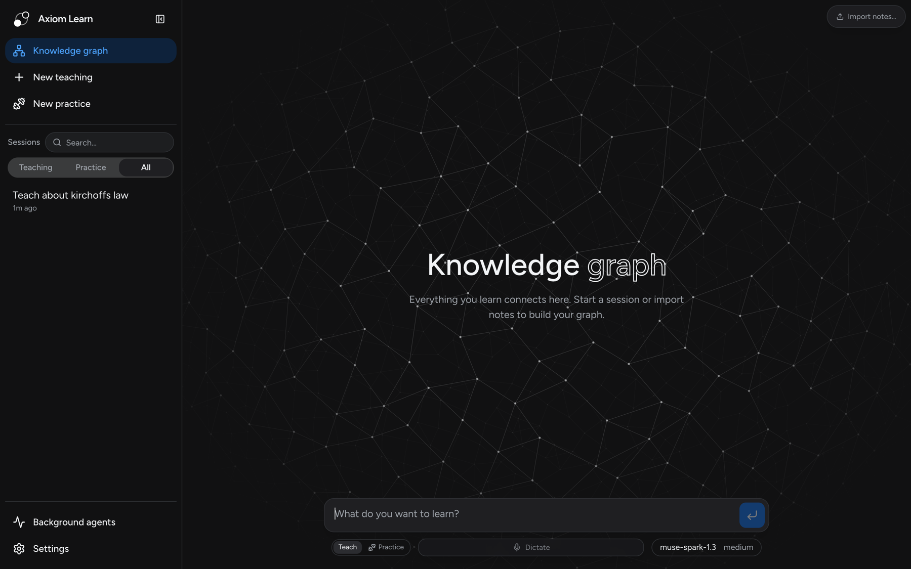

<p align="center">
  <picture>
    <source media="(prefers-color-scheme: dark)" srcset="docs/assets/kapany_banner_dark.png">
    <source media="(prefers-color-scheme: light)" srcset="docs/assets/kapany_banner_light.png">
    
  </picture>
</p>

<p align="center"><strong>An AI tutor that finds where your understanding ends, and teaches from there.</strong></p>

<p align="center">
  <a href="#what-was-built-during-the-hackathon">Built during the hackathon</a> ·
  <a href="#how-it-works">How it works</a> ·
  <a href="#built-with-meta-models">Meta models</a> ·
  <a href="#run-it-locally">Run it</a> ·
  <a href="#architecture">Architecture</a>
</p>

Most AI tutors explain. Kapany first measures what *you* already understand, plans a path from there to your goal, and teaches one reasoning step at a time, changing the plan as soon as your answers show it was wrong about you. Two people asking the same question get two different lessons, and the app shows why.

Built on Meta's Muse models for the **Meta Global AI Developer Hackathon** (Startup track).

## What was built during the hackathon

Kapany builds on an existing codebase, as the Startup track allows. Commit [`802e0a6`](../../commit/802e0a6) (Oct 26, before the Oct 27 start of the building period) is the **pre-hackathon baseline**: the adaptive-teaching backend (`src/core`, `src/agent`, `src/server`: measuring understanding, planning, teaching, grading, the knowledge graph store) and an earlier Next.js interface. Everything after it is new work, listed here with `git log 802e0a6..HEAD`.

**New during the hackathon**
- **A new front end and monorepo.** The backend was split into a pnpm/Turborepo monorepo and served on Hono, with a new Vite + React web app in place of the old Next.js one, made to work on phones.
- **The plan and the knowledge graph.** A visible plan map with confirm buttons and a sidebar, concept-done flow, an Obsidian-style network graph (including picking nodes by clicking them), session summaries and a search palette.
- **A textbook learning loop.** Courses, materials and folders, a "Planning your course" state, the probe explained in a side panel, and a node-trail loader.
- **Better measuring.** Required and spoken confidence, hands-free voice thinking and Meta dictation.
- **Attachments.** Images and PDFs pasted into the composer.
- **Models.** Local Ollama models alongside Meta's.
- **Rebrand** from Axiom Learn to Kapany, plus settings, color themes and layout work throughout.



## How it works

1. **Measure.** Before teaching, the agent probes each idea the goal depends on. Your answers, your confidence and your own explanation of your thinking show it where your understanding ends.
2. **Plan.** It builds a visible dependency map from that starting point to the goal. In the session above, it anchors on what the learner already holds ("charge doesn't vanish in wires") and targets the part they were unsure about (signs of voltage rises and drops).
3. **Teach.** Each step builds on something you already understand. You predict, get an explanation, then check your understanding. Confusions are repaired before anything is built on them, and the plan changes when your answers surprise it.
4. **Practice.** Separate sessions pose varied problems where you must recall the right idea without being told which one. Hints adapt to how you reason.

**Think out loud.** Every question has a thinking field for your reasoning and doubts, typed or dictated. That gives the agent a picture of *how* you think, not just a record of right and wrong answers.

## Knowledge that carries forward

Everything you learn is stored as claims and the reasoning chains that connect them, linked back to the session where you learned them. Later lessons read this knowledge graph instead of starting from scratch, and practice sessions draw their problems from it. You can also import your own notes.



## Built with Meta models

Each Meta model does a separate job in the teaching loop. All of them go through one Meta Model API key.

| Model | Role in Kapany | Status |
|---|---|---|
| **Muse Spark 1.3** | The tutor: measures understanding, plans, teaches, runs practice | Working |
| **Muse Spark 1.3 Contributor** | Low-cost background agents: building the knowledge graph, grading, research | Working (pick it for the background model slot) |
| **Muse Wonder** | Optional upgrade for the hardest planning | Available in the model picker |
| **Muse Voice Transcribe** | Dictation: speak your answers and thinking. Streamed in real time, sentence by sentence | Working |
| **SAM 3.1** | "Tap the part that…" questions on diagrams, graded against the real outline | In progress |
| **Muse Image** | Pictures drawn for the learner's specific confusion, checked by Muse Spark before they're shown | In progress |
| **Meta open-weights models** (Llama, via Ollama) | The same tutor running fully offline on your laptop, no key needed | Working (pick a model that supports tools) |

The app offers the Meta Model API, local models through [Ollama](https://ollama.com), Google Gemini, Claude and OpenAI keys, and sign-in with ChatGPT, GitHub Copilot or Grok subscriptions. Other providers are still supported underneath but hidden by default; start the server with `AXIOM_ALL_PROVIDERS=1` to show them in Settings.

## Run it locally

You need **Node.js 22+** and a [Meta Model API key](https://dev.meta.ai/docs/overview).

```bash
git clone https://github.com/Akas333/Axiom-Learn.git
cd Axiom-Learn
npm install
```

Start the API server and the web app, each in its own terminal:

```bash
npm run dev:server
```

```bash
npm run dev:web
```

Open http://localhost:5173, then:

1. Open **Settings → Providers → Add provider key**, choose **Meta**, and paste your key.
2. Open **Settings → Agent** and pick models for the three slots, for example `muse-spark-1.3` for the main tutor.
3. Type what you want to learn and press Enter.

**Running offline instead:** install [Ollama](https://ollama.com), run `ollama pull llama3.1`, and pick the local model in **Settings → Agent**. No key is needed. Set `OLLAMA_HOST` if Ollama isn't at `http://127.0.0.1:11434`. Small local models handle the agent's tool calls less reliably than Muse Spark.

Keys are saved on your machine only, in `packages/engine/auth.json`, which git ignores. You can also set `META_API_KEY` as an environment variable instead.

## Architecture

```
Browser ── apps/web (React + Vite) ──/api──▶ apps/server (Hono) ──▶ packages/engine ──▶ Meta Model API
                                     ws:/api/stt/realtime ─────────────────────────────▶ Muse Voice Transcribe
```

The repo is an npm-workspaces monorepo, built with Turborepo:

| Folder | What it is |
|---|---|
| [`packages/engine`](packages/engine) | The backend: domain core, teaching agents and prompts, stores, and every `/api` route handler ([`src/http`](packages/engine/src/http/index.ts)) |
| [`apps/server`](apps/server) | Hono server that mounts the engine's routes, plus the live dictation relay to Meta |
| [`apps/web`](apps/web) | The front end: React, Vite, Tailwind and React Router |

The engine is transport-neutral: each API route is a plain `Request → Response` function, so any server can mount the same code. Your API key never reaches the browser. Dictation audio goes through the server, which adds the key when it connects to Meta.

```bash
npm test             # every package; deterministic, no model calls, no network
npm run typecheck
npm run lint
```

More detail: [architecture](docs/architecture.md), [teaching method](docs/teaching-methodology.md), [development guide](docs/development.md).

## Your keys, your data

- **Your keys and models.** No subscription or markup. You pay providers for what you use, and a live meter shows the cost of each session.
- **Stored locally.** Sessions, the knowledge graph, settings and keys live on your machine as plain files you can inspect.
- **What leaves your machine.** Model requests send the context each task needs to your chosen provider. Dictation sends audio to Meta. Web research contacts search providers.
- **Inspectable.** The system prompts are visible and editable in Settings.

## License

[AGPL-3.0](LICENSE)
