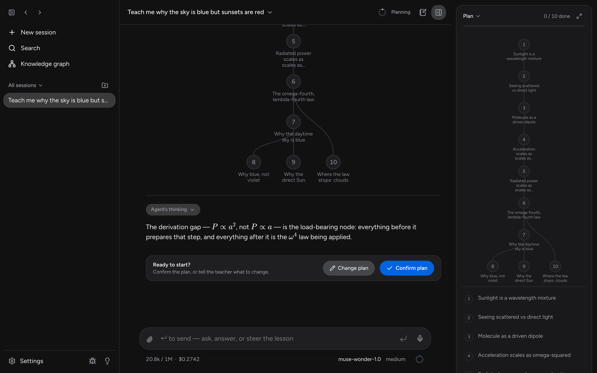
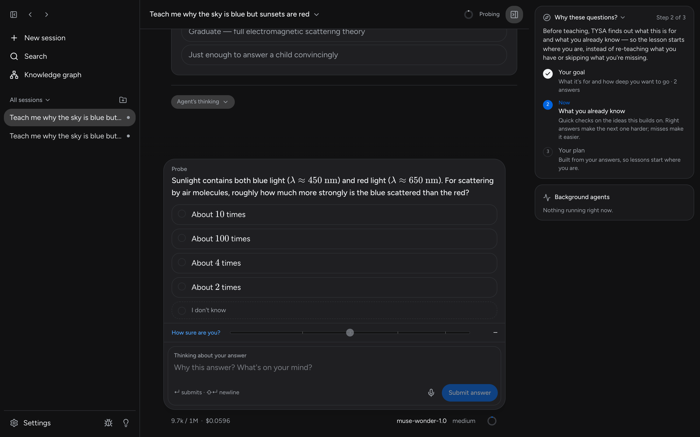
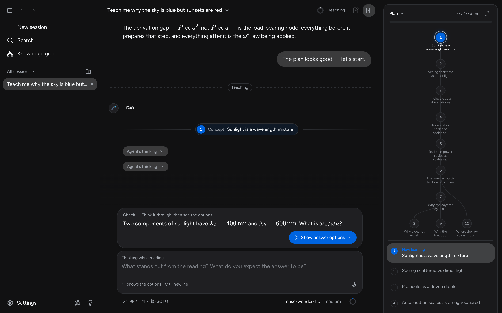
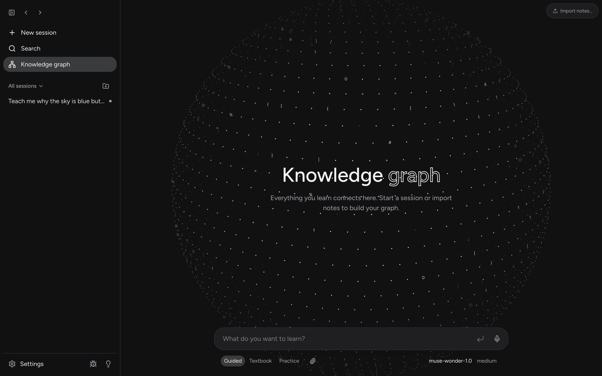

<h1 align="center">TYSA</h1>

<p align="center"><em>Teach Yourself Anything</em></p>

<p align="center"><strong>A learning harness that finds where your understanding ends, and teaches from there.</strong></p>

<p align="center">
  <a href="https://github.com/Akas333/TYSA/releases/latest"></a>
  <a href="https://github.com/Akas333/TYSA/actions/workflows/ci.yml"></a>
  <a href="LICENSE"></a>
</p>

<p align="center">
  <a href="#download">Download</a> ·
  <a href="#how-it-works">How it works</a> ·
  <a href="#built-with-meta-models">Meta models</a> ·
  <a href="#run-from-source">Run from source</a> ·
  <a href="#architecture">Architecture</a>
</p>

Most AI learning tools just explain. TYSA is an engineered learning harness: it first measures what *you* already understand, plans a path from there to your goal, and teaches one reasoning step at a time, changing the plan as soon as your answers show it was wrong about you. Two people asking the same question get two different lessons, and the app shows why.

Built on Meta's Muse models for the **Meta Global AI Developer Hackathon** (Indie Developer track).



## Download

TYSA is a desktop app for Mac, Windows and Linux. Get it from the **[latest release](https://github.com/Akas333/TYSA/releases/latest)**:

| Your computer | File |
|---|---|
| Mac with Apple Silicon (M1 and newer) | `TYSA-…-mac-arm64.dmg` |
| Mac with Intel | `TYSA-…-mac-x64.dmg` |
| Windows | `TYSA-…-win-x64.exe` |
| Linux, any distribution | `TYSA-…-linux-x86_64.AppImage` (or `…-linux-arm64.AppImage`) |
| Debian, Ubuntu | `TYSA-…-linux-amd64.deb` (or `…-linux-arm64.deb`) |
| Fedora, RHEL, openSUSE | `TYSA-…-linux-x86_64.rpm` (or `…-linux-aarch64.rpm`) |

Not sure which Mac you have? Apple menu → **About This Mac**: "Chip: Apple M…" means Apple Silicon.

Open the `.dmg` and drag **TYSA** into **Applications** (Mac), or run the `.exe` (Windows). On Linux, make the AppImage executable (`chmod +x`) and run it, or install the package (`sudo apt install ./TYSA-…deb` or `sudo dnf install ./TYSA-…rpm`). The first time it opens, TYSA walks you through connecting an AI and picking models. You need a [Meta Model API key](https://dev.meta.ai/docs/overview), or [Ollama](https://ollama.com) to run fully offline with no key.

> [!NOTE]
> The app isn't code-signed yet, so your computer warns you the first time you open it.
> - **Mac:** "Apple could not verify TYSA". Click **Done**, open **System Settings → Privacy & Security**, scroll down and click **Open Anyway**.
> - **Windows:** "Windows protected your PC". Click **More info**, then **Run anyway**.

## How it works

1. **Measure.** Before teaching, TYSA asks what the lesson is for, then probes each idea the goal depends on. Your answer, how sure you are, and your own explanation of your thinking show it where your understanding ends.
2. **Plan.** It builds a visible dependency map from that starting point to the goal. You confirm it or ask for changes before anything is taught.
3. **Teach.** Each step builds on something you already understand. You predict, get an explanation, then check your understanding. Confusions are repaired before anything is built on them, and the plan changes when your answers surprise it.
4. **Practice.** Separate sessions pose varied problems where you must recall the right idea without being told which one. Hints adapt to how you reason.



**Think out loud.** Every question has a field for your reasoning and doubts, typed or dictated. That gives TYSA a picture of *how* you think, not just a record of right and wrong answers.



## Knowledge that carries forward

Everything you learn is stored as claims and the reasoning chains that connect them, linked back to the session where you learned them. Later lessons read this knowledge graph instead of starting from scratch, and practice sessions draw their problems from it. You can also import your own notes.

Three ways to learn:
- **Guided:** the measure → plan → teach loop above.
- **Textbook:** courses built from your own materials (PDFs, images, notes), taught chapter by chapter.
- **Practice:** mixed problems drawn from your knowledge graph.



## Built with Meta models

Each Meta model does a separate job in the teaching loop. All of them go through one Meta Model API key.

| Model | Role in TYSA | Status |
|---|---|---|
| **Muse Spark** | The teaching agent: measures understanding, plans, teaches, runs practice | Working |
| **Muse Spark Contributor** | Low-cost background agents: building the knowledge graph, grading, research | Working |
| **Muse Wonder** | Optional upgrade for the hardest planning | Working |
| **Muse Voice Transcribe** | Dictation: speak your answers and thinking, streamed in real time | Working |
| **SAM 3.1** | "Tap the part that…" questions on diagrams, graded against the real outline | In progress |
| **Muse Image** | Pictures drawn for the learner's specific confusion, checked before they're shown | In progress |
| **Llama** (open weights, via Ollama) | The same harness running fully offline, no key needed | Working (pick a model that supports tools) |

TYSA also works with Google Gemini, Claude and OpenAI keys, and with ChatGPT, GitHub Copilot or Grok subscriptions. Other providers are supported underneath but hidden by default; set `AXIOM_ALL_PROVIDERS=1` to show them in Settings.

## Your keys, your data

- **No account, no subscription.** Bring your own keys and pay providers only for what you use. A live meter shows the cost of each session.
- **Stored locally.** Lessons, the knowledge graph, settings and keys live on your computer as plain files (`~/Library/Application Support/TYSA` on a Mac, `%APPDATA%\TYSA` on Windows).
- **What leaves your machine.** Model requests send the context each task needs to the provider you picked. Dictation sends audio to Meta. Web research contacts search providers.
- **Portable.** **Settings → Your data → Export** saves everything except your API keys into one passphrase-encrypted `.tysa` file. **Import** it on another computer; the data already there is backed up first.
- **Inspectable.** Every agent's system prompts are visible and editable in Settings.

## Run from source

With Node.js 22+ and git:

```bash
git clone https://github.com/Akas333/TYSA.git
cd TYSA
npm start
```

`npm start` installs dependencies, builds the web app and serves everything from one server at http://localhost:8787. For hot reload, run `npm run dev:server` and `npm run dev:web` in two terminals and open http://localhost:5173.

From source, keys are saved in `packages/engine/auth.json` (ignored by git) and data in `packages/engine/data`. You can also set `META_API_KEY` in the environment.

**Offline with Ollama:** install [Ollama](https://ollama.com), run `ollama pull llama3.1`, and pick the local model in **Settings → Agent**. Set `OLLAMA_HOST` if Ollama isn't at `http://127.0.0.1:11434`. Small local models handle the agents' tool calls less reliably than Muse Spark.

**Desktop app:** `npm start -w @axiom/desktop` runs it; `npm run dist -w @axiom/desktop` builds an installer for your computer. Pushing a `v*` tag builds every installer and publishes a GitHub release ([workflow](.github/workflows/release.yml), which also explains how to add code signing).

## Architecture

```
Desktop (Electron) ─┐
Browser ────────────┴─ apps/web (React + Vite) ──/api──▶ apps/server (Hono) ──▶ packages/engine ──▶ model providers
                                                ws:/api/stt/realtime ─────────────────────────────▶ Muse Voice Transcribe
```

An npm-workspaces monorepo built with Turborepo:

| Folder | What it is |
|---|---|
| [`packages/engine`](packages/engine) | The backend: domain core, teaching agents and prompts, stores, and every `/api` route handler ([`src/http`](packages/engine/src/http/index.ts)) |
| [`apps/server`](apps/server) | Hono server that mounts the engine's routes, serves the built web app, and relays live dictation to Meta |
| [`apps/web`](apps/web) | The front end: React, Vite, Tailwind and React Router |
| [`apps/desktop`](apps/desktop) | The Electron app: runs the server in the background and shows the web app in a window |
| [`skills/axiom-learn`](skills/axiom-learn) | An agent skill for reading TYSA's data folder from other AI tools |

The engine is transport-neutral: each API route is a plain `Request → Response` function, so any server can mount the same code. Your API key never reaches the browser; dictation audio goes through the server, which adds the key when it connects to Meta.

```bash
npm test             # every package; deterministic, no model calls, no network
npm run typecheck
npm run lint
```

More detail: [architecture](docs/architecture.md), [teaching method](docs/teaching-methodology.md), [development guide](docs/development.md), [keyboard shortcuts](docs/keyboard.md).

## License

[AGPL-3.0](LICENSE)
