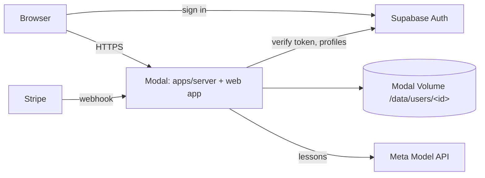

# Hosting Kapany

The hosted app is one container on [Modal](https://modal.com) that serves the web app and the API in multi-user mode (`KAPANY_HOSTED=1`). People sign in with [Supabase Auth](https://supabase.com/docs/guides/auth). Each user's lessons, knowledge graph, settings and keys live in their own folder on a Modal Volume. Profiles and plans live in Supabase.



## How it works

- **Sign-in.** The browser signs in with supabase-js (Google, or an emailed sign-in link). It posts its token to `/auth/session`, and the server stores it in an HttpOnly cookie. Requests that change data must come from the site's own origin.
- **Per-user data.** Every request runs as its user (`packages/engine/tenant.ts`), and every store resolves its paths under `/data/users/<user id>/`. Live events only reach the user they belong to. Chat ids from another account return 404.
- **Keys.** Users who add their own provider key in Settings → Providers use it with no limit. Everyone else runs on the platform `META_API_KEY`, with a monthly lesson limit by plan. The platform key never appears in any user's settings.
- **Plans.** Upgrading goes through Stripe Checkout. The Stripe webhook writes the plan to the user's Supabase profile and a local cache.
- **Desktop-only features.** Anki sync and ChatGPT subscription logins are turned off on the hosted app.

## One-time setup

### 1. Supabase

1. Create a project, then apply the profiles migration: `supabase db push`, or paste [`supabase/migrations/20261028000000_profiles.sql`](../supabase/migrations/20261028000000_profiles.sql) into the SQL editor.
2. **Authentication → URL Configuration:** set **Site URL** to your public address, and add `https://<your address>/**` to **Redirect URLs**. For local testing, also add `http://localhost:8787/**`.
3. **Authentication → Providers:** Email is on by default. To enable Google, create an OAuth client in Google Cloud. Its redirect URI is `https://<project>.supabase.co/auth/v1/callback`. Paste the client ID and secret into Supabase.
4. **Project Settings → API keys:** copy the publishable key and the secret key.

### 2. Stripe (optional)

1. Create a product "Kapany Pro" with a monthly price, and copy the price id (`price_…`).
2. **Developers → Webhooks:** add the endpoint `https://<your address>/billing/webhook` with the events `checkout.session.completed`, `customer.subscription.updated` and `customer.subscription.deleted`. Copy the signing secret (`whsec_…`).
3. Turn on the customer portal (**Settings → Billing → Customer portal**).

Leave the Stripe values empty to launch without paid plans. The Upgrade button then stays hidden.

### 3. Modal

```bash
pip install modal
```

```bash
modal setup
```

```bash
cp deploy/hosted.env.example deploy/hosted.env
```

Fill in `deploy/hosted.env` (it's gitignored), then:

```bash
modal secret create kapany-secrets --from-dotenv deploy/hosted.env --force
```

```bash
modal deploy deploy/modal/kapany.py
```

The deploy prints the app's URL (`https://<workspace>--kapany-web.modal.run`). Put that address into `KAPANY_SITE_URL` and into Supabase's URL settings, then run the `modal secret create` and `modal deploy` commands again.

### 4. Automatic deploys

Add the repository secrets `MODAL_TOKEN_ID` and `MODAL_TOKEN_SECRET`. [`.github/workflows/deploy.yml`](../.github/workflows/deploy.yml) then deploys every time CI passes on `main`, and you can also run it by hand.

## Running hosted mode locally

Use your Supabase project with `http://localhost:8787` in its redirect URLs:

```bash
npm run build -w @axiom/web
```

```bash
KAPANY_HOSTED=1 LH_DATA_DIR=./data/hosted SUPABASE_URL=https://<project>.supabase.co SUPABASE_ANON_KEY=<publishable key> META_API_KEY=<key> npm run start -w @axiom/server
```

Open http://localhost:8787.

## Limits of this phase

- **One container.** Live lessons, background jobs and event streams are held in memory, so `max_containers=1`. One container serves many concurrent users. Scaling out needs phase 2, which moves this state and the per-user files into Supabase.
- **Volume saves.** The deploy saves the Volume every 30 seconds and on shutdown. A crash can lose the last few seconds of writes.
- **Long streams.** Modal limits web requests to 150 seconds. Check after the first deploy that lessons and the `/api/events` stream run past that.
- **Backups.** Snapshot the Volume regularly (`modal volume get kapany-data / ./backup`).
